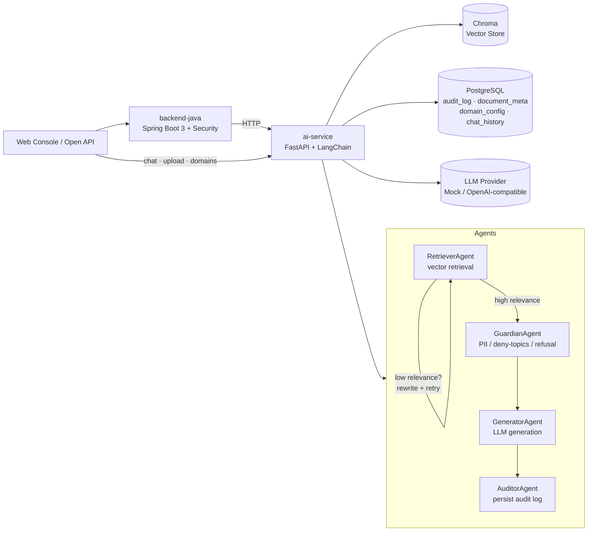

# RAGentHub — Enterprise Multi-Agent RAG Platform


> A production-style, multi-agent RAG platform that can be **re-skinned into any domain** — finance, government, healthcare, or internal knowledge base.

RAGentHub is a **RAG + Agent backend template** built for portfolio and production readiness. It implements the full pipeline: `document upload → parsing & chunking → vectorization → retrieval-augmented generation → multi-agent orchestration → security audit → REST API`, with **config-driven domain switching** so the same codebase adapts to banking, government, healthcare, or internal knowledge base scenarios.

---

## ✨ Features

| Capability | Description |
|---|---|
| 🔍 **RAG Pipeline** | Document parsing (PDF/MD/TXT), recursive chunking, Chroma vector store, cosine similarity retrieval |
| 🔄 **Retrieval Reflection Loop** | If top-1 relevance score is below threshold, auto-rewrite query (expand synonyms/keywords) and retry — smarter retrieval |
| 🤖 **Multi-Agent Orchestration** | `RetrieverAgent` / `GuardianAgent` / `GeneratorAgent` / `AuditorAgent` — four-role collaboration |
| 🧭 **Runtime Domain Management** | Create, update and delete domains from the console — persisted in PostgreSQL, no redeploy needed |
| 💬 **Persistent Conversations** | Per-user, per-domain chat history stored in the database and restored on reload |
| 🧠 **Multi-Turn Conversation** | Previous turns are fed back into the prompt, and pronoun-based follow-ups ("它呢？") are folded into the retrieval query |
| 🔐 **Access Control** | API-key authentication (`X-API-Key` / Bearer), per-caller rate limiting backed by Redis, domain isolation, PII regex masking, full audit log |
| 🧩 **Dual-Language Microservices** | Java Spring Boot 3 primary service + Python FastAPI AI service, decoupled via HTTP |
| 📦 **Zero-Dependency Local Run** | Default SQLite + embedded Chroma, no MySQL / Redis / Kafka required; production configs can be switched to PostgreSQL + Redis + Kafka with one env var |
| 🗄 **Durable Storage** | Chroma vectors live on a named volume, ONNX embedding cache is seeded from a local model mount — data survives container recreation |
| 🧪 **Engineering Quality** | 13 pytest contract tests, Swagger docs, structured logging, unified error responses, GitHub Actions CI |

---

## 🏗 Architecture



See [docs/architecture.md](docs/architecture.md) for details.

---

## 🚀 Quick Start

### 1. Run Python AI Service Only (zero external dependencies)

```powershell
cd ai-service
python -m venv .venv
.\.venv\Scripts\Activate.ps1
pip install -r requirements.txt

# Ingest sample corpus
python -m app.scripts.ingest --domain medical

# Start server
uvicorn app.main:app --reload --port 8000
```

Open http://localhost:8000 — it auto-redirects to Swagger (http://localhost:8000/docs).

### 2. Docker Compose Full Stack

```powershell
# Start all services (PostgreSQL + Redis + Java + Python AI + Web Console)
docker compose up -d

# Wait ~30 seconds for services to be ready, then visit:
#   - Python Swagger:  http://localhost:8000/docs
#   - Java API:        http://localhost:8080  (Basic Auth: admin / admin123)
#   - Web Console:     http://localhost:8088
```

**China network notes:**
- Docker Hub requires registry mirrors (configured in `daemon.json`)
- Maven build requires Aliyun mirror (configured in `settings.xml`)
- The ONNX embedding model is **not downloaded at runtime** — the local
  `all-MiniLM-L6-v2/` directory is mounted read-only into the container and the
  entrypoint seeds the Chroma cache from it, so first boot works fully offline

**Data persistence:**

| Volume | Mount | Purpose |
|---|---|---|
| `pg_data` | `/var/lib/postgresql/data` | PostgreSQL data |
| `ai_data` | `/data` | Chroma vector store |
| `onnx_cache` | `/root/.cache/chroma/onnx_models` | Embedding model cache |

### 3. Start Java Primary Service (requires JDK 17 + Maven)

```powershell
cd backend-java
mvn spring-boot:run
```

Java service listens on `8080`, Basic Auth default `admin / admin123`, and proxies `/api/chat` to Python service on `8000`.

### 4. Run Tests

```powershell
cd ai-service
pip install -r requirements-dev.txt
pytest tests/ -v
```

---

## 🔁 Multi-Domain Reskinning Example

| Domain | Corpus Directory | Sample Question |
|---|---|---|
| 🏦 Finance | `examples/finance/` | "What is the risk rating of product X?" |
| 🏛 Government | `examples/gov/` | "What documents are required for public institution exam registration?" |
| 🏥 Healthcare | `examples/medical/` | "What task is the PCLT20K dataset used for?" |

Reskin in two steps:

```yaml
# config/domain.yaml
domain:
  name: finance           # switch to finance / gov / medical
  system_prompt: "You are a compliance support agent for a bank. Only answer product and process questions."
  guardrails:
    deny_topics: ["stock_price", "insider_info", "guaranteed_return", "medication", "diagnosis", "prescription"]
```

```powershell
python -m app.scripts.ingest --domain finance
```

---

## 📚 API Examples

```bash
# Ask a question (full RAG + Agent pipeline)
curl -X POST http://localhost:8000/api/v1/chat \
  -H "Content-Type: application/json" \
  -d '{"question": "What is a fixed deposit?", "domain": "finance"}'

# Upload a document
curl -X POST http://localhost:8000/api/v1/documents \
  -F "file=@examples/finance/product-brochure.md" \
  -F "domain=finance"

# Recent audit logs
curl http://localhost:8000/api/v1/audit/recent
```

When `API_KEY` is configured, add the header to every `/api/v1/*` call:

```bash
curl -H "X-API-Key: $API_KEY" http://localhost:8000/api/v1/domains
# or: -H "Authorization: Bearer $API_KEY"
```

See [docs/api.md](docs/api.md) for the full API reference.

---

## 🔐 Security Model

| Layer | Implementation | Control |
|---|---|---|
| Authentication | `X-API-Key` header or `Authorization: Bearer`, constant-time compare | `API_KEY` (empty = dev mode) |
| Rate limiting | Fixed one-minute window per key/IP, shared through Redis so the budget holds across replicas | `RATE_LIMIT_PER_MINUTE` (0 = off) |
| Tenant isolation | Documents, vectors and conversations are namespaced by `domain` | — |
| PII protection | GuardianAgent masks phone / ID card / bank card on input **and** output | — |
| Refusal policy | `deny_topics` short-keyword matching, refuses before generation | `config/domain.yaml` |
| Traceability | Every answer writes `audit_log`; conversations write `chat_history` | — |

`/health`, `/docs` and `/web` stay open so probes and the UI work without a key.

> Deployment note: the API key travels in a header, so terminate TLS in front of
> the service (nginx / ingress) in any environment that is not localhost.

---

## 📁 Project Structure

```
RAGentHub/
├── README.md
├── LICENSE
├── docs/
│   ├── architecture.md      # Architecture design
│   ├── api.md                # API documentation
│   └── github-push.md        # GitHub push guide
├── backend-java/             # Spring Boot 3 primary service
│   ├── pom.xml
│   └── src/main/
├── ai-service/               # FastAPI + LangChain AI service
│   ├── requirements.txt
│   ├── requirements-dev.txt
│   ├── tests/
│   └── app/
├── web/                      # Minimal frontend (HTML + Fetch)
├── examples/                 # Multi-domain sample corpus
│   ├── finance/
│   ├── gov/
│   └── medical/
├── config/
│   └── domain.yaml           # Domain reskin config
├── scripts/
│   └── start-dev.ps1
└── data/                     # Local SQLite / Chroma data (gitignored)
```

---

## 🗺 Roadmap

- [x] Python RAG MVP + multi-agent skeleton
- [x] Java Spring Boot primary service skeleton
- [x] pytest smoke tests
- [x] PostgreSQL / pgvector abstraction (`VECTOR_BACKEND=pgvector` toggle)
- [x] Redis cache + Kafka async chunking (`CACHE_BACKEND=redis` / `EVENT_BUS=kafka`)
- [x] React + Vite knowledge base console (`web-console/`)
- [x] Docker / docker-compose one-click deployment (PG + pgvector + Redis + Kafka + AI + Java + Web)
- [x] RAGAS evaluation script (`ai-service/evals/eval_ragas.py`)

---

## 📄 License

[MIT](./LICENSE)
