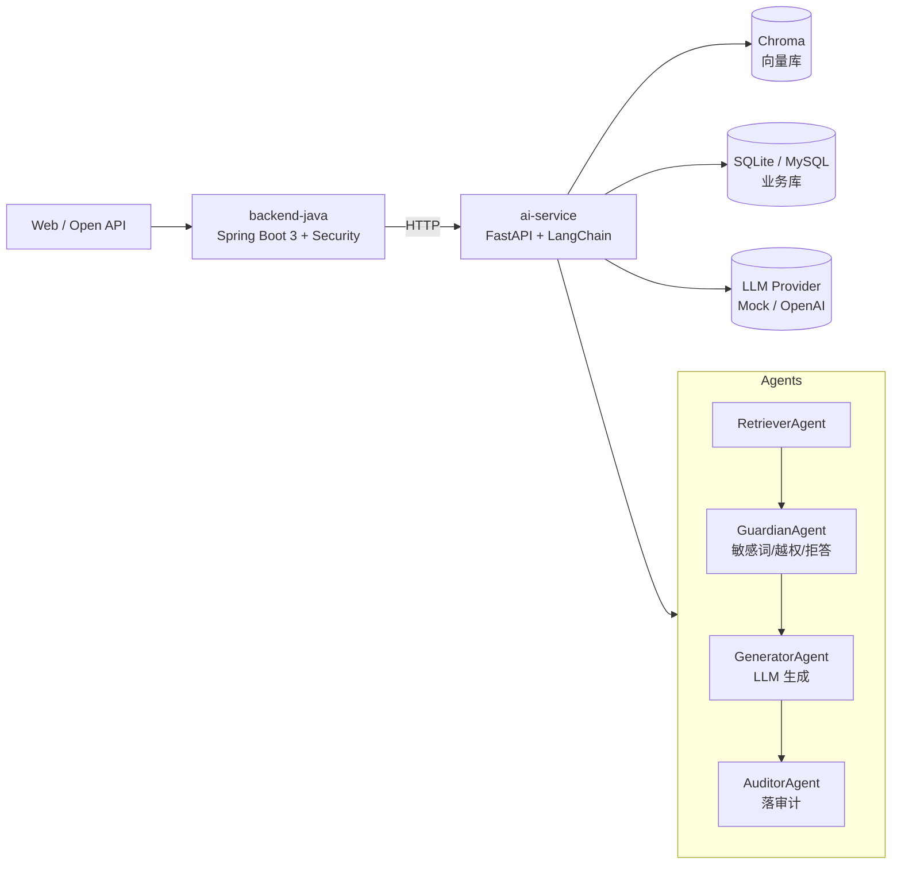

# RAGentHub — 企业级 RAG 多智能体平台


> A production-style, multi-agent RAG platform that can be **re-skinned into any domain** — finance, government, healthcare, or internal knowledge base.

RAGentHub 是一个面向求职与工程落地的 **RAG + Agent 后端模板**。它把「文档上传 → 解析切分 → 向量化 → 检索增强 → 多智能体编排 → 安全审计 → 对外 API」整条链路做完整，并通过**配置换装**的方式让同一套代码适配银行、政务、医疗、企业内部知识库等不同业务场景。

---

## ✨ 特性

| 能力 | 说明 |
|---|---|
| 🔍 **RAG 流水线** | 文档解析（PDF/MD/TXT）、递归切分、Chroma 向量库、余弦相似度检索 |
| 🤖 **多智能体编排** | `RetrieverAgent` / `GuardianAgent` / `GeneratorAgent` / `AuditorAgent` 四角色协作 |
| 🔐 **数据治理 / 安全** | RBAC、文档级 domain 隔离、敏感词正则脱敏（手机/身份证/银行卡）、全量审计日志 |
| 🧩 **双语言微服务** | Java Spring Boot 3 主服务 + Python FastAPI AI 服务，HTTP 解耦 |
| 🔄 **多行业换装** | 改 `config/domain.yaml` + 替换 `examples/<domain>/` 语料即可换业务 |
| 📦 **零依赖本地跑** | 默认 SQLite + Chroma 嵌入式，无需 MySQL / Redis / Kafka；生产配置可一键切到 MySQL + Redis + Kafka |
| 🧪 **工程质量** | pytest smoke test、Swagger 自动文档、双端审计双写 |

---

## 🏗 架构



详见 [docs/architecture.md](docs/architecture.md)。

---

## 🚀 快速开始

### 1. 本地只跑 Python AI 服务（推荐，零外部依赖）

```powershell
cd ai-service
python -m venv .venv
.\.venv\Scripts\Activate.ps1
pip install -r requirements.txt

# 灌入示例语料
python -m app.scripts.ingest --domain medical

# 启动
uvicorn app.main:app --reload --port 8000
```

打开 http://localhost:8000 会自动跳到 Swagger（http://localhost:8000/docs），直接发请求。

### 2. 一键启动脚本（Windows）

```powershell
.\scripts\start-dev.ps1
```

### 3. 启动 Java 主服务（需要 JDK 17 + Maven）

```powershell
cd backend-java
mvn spring-boot:run
```

Java 服务默认监听 `8080`，Basic Auth 默认 `admin / admin123`，会把 `/api/chat` 透传到 Python 服务 `8000`。

### 4. 跑测试

```powershell
cd ai-service
pip install -r requirements-dev.txt
pytest tests/ -v
```

---

## 🔁 多行业换装示例

| 行业 | 语料目录 | 典型问题 |
|---|---|---|
| 🏦 金融 | `examples/finance/` | "某理财产品的风险等级是什么？" |
| 🏛 政务 | `examples/gov/` | "事业单位统考报名需要哪些材料？" |
| 🏥 医疗 | `examples/medical/` | "PCLT20K 数据集用于什么任务？" |

换装只需两步：

```yaml
# config/domain.yaml
domain:
  name: finance           # 切到 finance / gov / medical
  system_prompt: "你是某银行的合规客服，只回答与产品、流程相关的问题。"
  guardrails:
    deny_topics: ["股价预测", "内幕消息"]
```

```powershell
python -m app.scripts.ingest --domain finance
```

---

## 📚 API 示例

```bash
# 提问（走完整 RAG + Agent 链路）
curl -X POST http://localhost:8000/api/v1/chat \
  -H "Content-Type: application/json" \
  -d '{"question": "什么是定期存款？", "domain": "finance"}'

# 上传文档
curl -X POST http://localhost:8000/api/v1/documents \
  -F "file=@examples/finance/产品手册.md" \
  -F "domain=finance"

# 最近审计
curl http://localhost:8000/api/v1/audit/recent
```

完整接口列表见 [docs/api.md](docs/api.md)。

---

## 📁 目录结构

```
RAGentHub/
├── README.md
├── LICENSE
├── docs/
│   ├── architecture.md      # 架构设计
│   ├── api.md                # API 文档
│   └── github-push.md        # 推 GitHub 步骤
├── backend-java/             # Spring Boot 3 主服务
│   ├── pom.xml
│   └── src/main/
├── ai-service/               # FastAPI + LangChain AI 服务
│   ├── requirements.txt
│   ├── requirements-dev.txt
│   ├── tests/
│   └── app/
├── web/                      # 极简前端（HTML + Fetch）
├── examples/                 # 多行业示例语料
│   ├── finance/
│   ├── gov/
│   └── medical/
├── config/
│   └── domain.yaml           # 行业换装配置
├── scripts/
│   └── start-dev.ps1
└── data/                     # 本地 SQLite / Chroma 数据（gitignore）
```

---

## 🗺 路线图

- [x] Python RAG MVP + 多 Agent 骨架
- [x] Java Spring Boot 主服务骨架
- [x] pytest smoke test
- [ ] 接入 PostgreSQL / pgvector
- [ ] 接入 Redis 缓存 + Kafka 异步切分
- [ ] 前端知识库管理台（Vue/React）
- [ ] Docker / docker-compose 一键部署
- [ ] RAGAS 评估脚本

---

## 📄 License

[MIT](./LICENSE)
